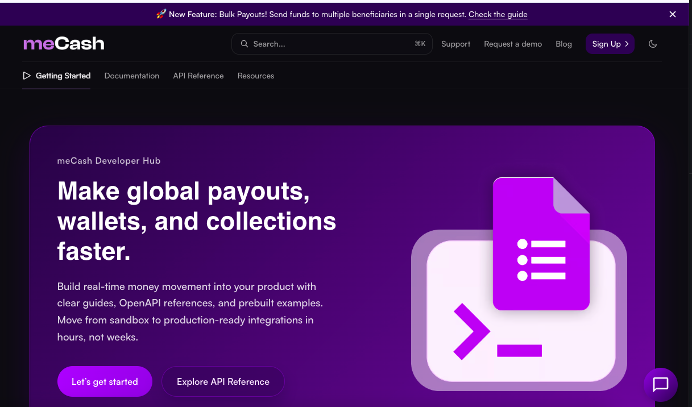

  

<h1 align="center">Hi, I'm Ejiro Onose</h1>

  Machine Learning Engineer · Technical Writer · Speaker · Part-time Chef

  
  
  
  
  
  
  

  
  

---

I build machine learning systems and write about them. Most of my work sits at the
intersection of LLM infrastructure, interpretability, and developer education —
turning research and tooling into things engineers can actually use.

- Writing about LLM interpretability, agent observability, and RAG architecture
- Publishing in **Towards AI**, **Data Science Collective**, **AI in Plain English**, and **Techloy**
- Covering fintech, payments, and cross-border infrastructure on the **meCash** blog
- Open to collaborating on interesting projects
- Reach me at [onose75@gmail.com](mailto:onose75@gmail.com)

---

## Shipped Work

### [meCash Developer Documentation →](https://developer.me-cash.com/)

Built and maintain the developer documentation for meCash's cross-border payments
platform: API reference, authentication, sandbox guides, and integration walkthroughs
for the Ramp and Payment Links APIs.

`Mintlify` `OpenAPI` `MDX` `Docs-as-Code`

---

## Featured Projects

| Project | Description | Tech Stack |
| :--- | :--- | :--- |
| **[Legal AI Assistant](https://github.com/Joggyjagz7/Legal-ai-assistant)** | AI assistant for legal document analysis, summarization, and querying using RAG. | `LangChain` `Streamlit` `VectorDBs` `LLMs` |
| **[Gemini AI Researcher](https://github.com/Joggyjagz7/Gemini-AI-Reseacher-with-Citations)** | Research agent that uses Gemini to find information and return accurate citations. | `Gemini API` `Python` `LangChain` `Streamlit` |
| **[Local LLM Agent w/ Monitoring](https://github.com/Joggyjagz7/Local-LLM-Agent-With-Monitoring)** | Autonomous agent on local LLMs with real-time performance and drift monitoring. | `Python` `LangChain` `Ollama` `Prometheus` |
| **[Company Researcher Agent](https://github.com/Joggyjagz7/company-researcher)** | Agent that researches companies, gathers public data, and generates summary reports. | `LangChain Agents` `SerpAPI` `LLMs` `Python` |
| **[Advanced RAG Techniques](https://github.com/Joggyjagz7/RAG-Techniques-from-Papers)** | Implementations of advanced RAG strategies sourced from recent academic papers. | `Python` `LangChain` `PyTorch` `VectorDBs` |
| **[Local Text-to-Image](https://github.com/Joggyjagz7/Local-Text-to-Image-with-DeepSeek-Janus)** | Locally-run text-to-image generator powered by DeepSeek-Janus. | `DeepSeek` `Python` `Gradio` `Transformers` |
| **[RAG Project Testbed](https://github.com/Joggyjagz7/RAG-project-test)** | Experimental harness for testing and evaluating RAG techniques. | `Python` `LangChain` `VectorDBs` `Hugging Face` |

---

## What I Work With

**ML / AI** — LLMs, RAG, agents, interpretability, computer vision, PyTorch, Hugging Face, LangChain, Ollama

**MLOps** — feature stores, experiment tracking, monitoring, drift detection, model observability

**Infrastructure** — AWS, GCP, Kubernetes, Ambassador Edge Stack, Jenkins, Pulumi, GitOps

**Engineering** — Python, JavaScript, Django, Flutter, HTML/CSS, Web3

**Writing** — technical documentation, docs-as-code, developer education, API reference

---

## Selected Writing

### LLM Interpretability & Model Internals
- [The Complete Guide to Reading a Model's Hidden Layers with Anthropic's Jacobian Lens](https://medium.com/towards-artificial-intelligence/the-complete-guide-to-reading-a-models-hidden-layers-with-anthropic-s-jacobian-lens-c564c9ac4fcf)
- [Inside the Black Box: The State of LLM Interpretability in 2026](https://medium.com/ai-in-plain-english/inside-the-black-box-the-state-of-llm-interpretability-in-2026-5cd71042c95e)
- [Anthropic Found a Global Workspace Inside Language Models — Here's What It Means](https://medium.com/ai-in-plain-english/anthropic-found-a-global-workspace-inside-language-models-here-s-what-it-means-b8a3d4a8370b)
- [Hallucination in Large Language Models](https://medium.com/ai-in-plain-english/hallucination-in-large-language-models-08871ba468d1)

### Fintech & Payments
Writing on cross-border payments, stablecoin rails, and African fintech infrastructure
for meCash — full archive at [blog.me-cash.com/author/ejiro](https://blog.me-cash.com/author/ejiro/).

### RAG, Retrieval & Context
- [Open Knowledge Format (OKF) vs Vector Databases: Why Your RAG Needs a New Knowledge Format](https://medium.com/towards-artificial-intelligence/open-knowledge-format-okf-vs-vector-databases-why-your-rag-needs-a-new-knowledge-format-1ec88e44204c)
- [DeepSeek-OCR: Solving LLM Context Limits with Optical Compression](https://medium.com/@EjiroOnose/deepseek-ocr-solving-llm-context-limits-with-optical-compression-7ab7c25b87ab)
- [Vector Database: What Is It and Why You Should Know It?](https://medium.com/@EjiroOnose/vector-database-what-is-it-and-why-you-should-know-it-ae7e7dca82a4)

### Observability & Evaluation
- [From LLM Logging to Agent Observability: How We Monitor and Evaluate AI Systems in 2026](https://medium.com/ai-in-plain-english/from-llm-logging-to-agent-observability-how-we-monitor-and-evaluate-ai-systems-in-2026-5651178a7c4d)
- [Why Observability Is Important for Large Language Models](https://medium.com/@EjiroOnose/why-observability-is-important-for-large-language-models-llms-1967c509d127)
- [LLMs on Trial: Understanding LLM Evaluation Benchmarks](https://medium.com/ai-in-plain-english/llms-on-trial-understanding-llm-evaluation-benchmarks-ac7336ec2f3b)
- [LLMs on Trial: The African LLM Evaluation Benchmarks Edition](https://medium.com/@EjiroOnose/llms-on-trial-the-african-llm-evaluation-benchmarks-edition-9658fcf62642)
- [ML Monitoring vs ML Observability](https://www.aporia.com/blog/ml-observability-vs-ml-monitoring/)
- [How to Improve Model Performance with ML Monitoring](https://www.aporia.com/blog/improving-model-performance-with-ml-monitoring/)
- [How to Choose the Right Solution for Machine Learning Monitoring](https://www.aporia.com/blog/how-to-choose-the-right-solution-for-machine-learning-monitoring/)
- [How to Automate Data Drift Thresholding in Machine Learning](https://deepchecks.com/how-to-automate-data-drift-thresholding-in-machine-learning/)
- [Explainability and Auditability in Machine Learning](https://neptune.ai/blog/explainability-auditability-ml-definitions-techniques-tools)

### Running LLMs Locally
- [Build a Local Code Review & Refactoring Assistant with OpenClaw + Ollama](https://medium.com/illumination/build-a-local-code-review-refactoring-assistant-with-openclaw-ollama-7f0075de4b56)
- [The Complete Guide to Running Large Language Models Locally with Phoenix and Ollama](https://medium.com/@EjiroOnose/the-complete-guide-to-running-large-language-models-locally-with-phoenix-and-ollama-06c5f93c65cd)

### MLOps & Data Infrastructure
- [Why Your 2026 AI Stack Still Needs a Feature Store](https://medium.com/towards-artificial-intelligence/why-your-2026-ai-stack-still-needs-a-feature-store-80dda4d478f5)
- [Machine Learning as a Service](https://neptune.ai/blog/machine-learning-as-a-service-what-it-is-when-to-use-it-and-what-are-the-best-tools-out-there)
- [Azure ML Alternatives for MLOps](https://neptune.ai/blog/azure-ml-alternatives-for-mlops)
- [How to Solve Reproducibility in Machine Learning](https://neptune.ai/blog/how-to-solve-reproducibility-in-ml)
- [Best Data Lineage Tools](https://neptune.ai/blog/best-data-lineage-tools)
- [Building Machine Learning Chatbots: Choose the Right Platform and Applications](https://neptune.ai/blog/building-machine-learning-chatbots-platforms-and-applications)

### Platform & DevOps
- [Kubernetes Development Environments: From Local to Remote](https://blog.getambassador.io/kubernetes-development-environments-from-local-to-remote-4e33131147c6)
- [Ambassador Edge Stack vs Traefik vs NGINX](https://medium.com/ambassador-api-gateway/ambassador-edge-stack-vs-traefik-vs-nginx-8a699bc99166)
- [Using Knative and Ambassador Edge Stack to Handle Traffic](https://medium.com/ambassador-api-gateway/using-knative-and-ambassador-edge-stack-to-handle-traffic-5b938470d51f)
- [Secrets Management with GitOps and Kubernetes](https://www.stakater.com/post/secrets-management-with-gitops-and-kubernetes)
- [Opta vs Pulumi](https://medium.com/faun/opta-vs-pulumi-39287fc130fd)
- [What Is Kubernetes Lens](https://lightrun.com/what-is-kubernetes-lens/)

### Product, Docs & Developer Experience
- [The AI Product Problem](https://medium.com/@EjiroOnose/the-ai-product-problem-7f6a251faf2f)
- [Understanding Docs-as-Code](https://medium.com/@EjiroOnose/understanding-docs-as-code-01b8c7644e23)
- [Building Topical Relevance for Your SaaS Product: A Guide for Tech Teams](https://medium.com/@EjiroOnose/building-topical-relevance-for-your-saas-product-a-guide-for-tech-teams-5abde1b5e3b4)

### Web3
- [Tokenomics](https://medium.com/@EjiroOnose/tokenomics-48ebacf79cde)
- [Blockchain Simplified](https://medium.com/@EjiroOnose/blockchain-simplified-aa8a2d0b816d)

> More on [Medium](https://medium.com/@EjiroOnose), [Techloy](https://www.techloy.com/author/ejiro), and the [meCash blog](https://blog.me-cash.com/author/ejiro/).

---

## GitHub Stats

  
  

  

